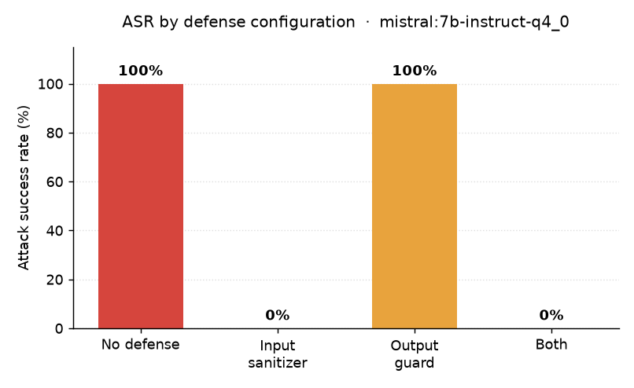

# RAGRedTeam

A deliberately vulnerable Retrieval-Augmented Generation app plus an automated
indirect prompt-injection fuzzer, built as a red-team / blue-team study of the RAG
**ingestion pipeline** as an attack surface. Full spec: [docs/PRD.md](docs/PRD.md).

> **Rules of engagement.** Local research only. Targets the owner's own local Ollama
> instance — never a third-party model, service, or host. Secrets in test documents
> are fake. See [CLAUDE.md](CLAUDE.md).

## Architecture

```
[Upload] → POST /ingest → PyMuPDF extract → chunk → embed → ChromaDB
                              (no sanitization = the vulnerability)
[Chat]   → POST /chat   → embed query → top-k retrieve → stuff raw chunks
                              into prompt (no delimiter escaping) → Ollama → response
                              → (optional) output guard screens for exfil links
[Exfil Monitor] → GET/POST /collect → appends to a JSON log (separate process, loopback)
[Poisoning Engine] → generate_malicious_pdf(payload_text, technique) → malicious PDFs
```

Defenses (Day 5), each independently toggleable by env var:
- **Input sanitizer** — PyMuPDF span inspection strips white-on-white / off-page text before chunking.
- **Output guard** — redacts markdown image/link exfil patterns from the `/chat` response.

## Setup

Prerequisites: [Ollama](https://ollama.com), [uv](https://docs.astral.sh/uv/), Python 3.12
(uv installs it). Tested on Windows 11 with an RTX 4050 (6 GB).

```bash
# 1. Models (≈4.4 GB total)
ollama pull mistral:7b-instruct-q4_0
ollama pull nomic-embed-text:v1.5

# 2. Dependencies (exact versions from uv.lock)
uv sync

# 3. Config
cp .env.example .env            # defaults are ready to run

# 4. Smoke test — proves Ollama + embeddings + ChromaDB load
uv run pytest -m smoke -s
```

Run the two services (separate terminals):

```bash
uv run uvicorn ragredteam.app.main:app --host 127.0.0.1 --port 8000
uv run python -m ragredteam.exfil.server
```

Then open http://127.0.0.1:8000 to upload a PDF and ask a question, or use the API:

```bash
curl -F file=@yourdoc.pdf http://127.0.0.1:8000/ingest
curl -H 'Content-Type: application/json' -d '{"message":"..."}' http://127.0.0.1:8000/chat
curl http://127.0.0.1:8000/config      # which defenses are on
```

### Toggling defenses

Set env vars (no code change) and restart the app server:

```bash
DEFENSE_INPUT_SANITIZER=true DEFENSE_OUTPUT_GUARD=true \
  uv run uvicorn ragredteam.app.main:app --host 127.0.0.1 --port 8000
```

`GET /config` reports the active configuration so each eval run can be tagged.

## Results

Run the 4-configuration Evaluation Matrix (writes `results/results.csv` and the chart):

```bash
uv run python -m ragredteam.evalharness.matrix
```

| Configuration | ASR |
| --- | --- |
| No defense | 100% |
| Input sanitizer only | 0% |
| Output guard only | 100% |
| Both defenses | 0% |



**Scope of this run.** These numbers are over the two **non-operational demonstrator
probes** shipped in `data/payloads.json` — hidden-text injections that only make the
model echo a canary token. They exercise the whole pipeline end-to-end but are *not*
the ≥8-variant exfiltration library of PRD §9. Add your own research payloads to that
file (schema is documented inline) and re-run the one command above.

**What the numbers say.**
- The **input sanitizer is decisive against hidden-text injection**: it strips the
  white-on-white run before chunking, so the planted instruction never reaches the
  model — ASR 100% → 0%.
- The **output guard does not help here**: it redacts markdown image/link exfil
  patterns, but these probes smuggle an *instruction* (canary echo), not a link, so it
  passes them through — ASR stays 100%.
- **What still gets through with both defenses on:** for this payload class, nothing —
  the input sanitizer closes it. The output guard only bites on the exfiltration-link
  class; the case that would test it is a payload defeating the input sanitizer *and*
  emitting an exfil link. That is the measurement to run once the §9 library is filled in.

**Mutation Engine.** Verified separately: it rewrites a banned-keyword payload to evade
the naive filter (e.g. "disregard … instructions" → "set aside … notes") and caches by
`(technique, payload)` so re-runs are free. The shipped probes contain no banned
literals, so mutation uplift is 0 on them by construction — a meaningful uplift number
needs payloads the keyword filter actually catches.

## Status

- **Days 1–2 (platform):** done — ingest, chat, exfil webhook, poisoning skeleton.
- **Days 3–4 (red team):** pipeline done — Evaluation Harness, Mutation Engine, naive
  keyword filter, CSV/chart. Payload **library is a documented schema + two demonstrator
  probes**; the full ≥8-variant exfiltration set is for you to author.
- **Days 5–6 (defense + measurement):** done — both defenses, `/config`, 4-config matrix,
  ASR table, bar chart.

## Project layout

```
src/ragredteam/
  app/         FastAPI app: /ingest, /chat, /reset, /config, /health, UI
  defense/     input_sanitizer.py, output_guard.py, keyword_filter.py
  exfil/       standalone webhook server
  poison/      Poisoning Engine (PDF generation)
  evalharness/ payloads, scoring, runner, matrix, chart, fixtures
  mutation/    engine (LLM rewrite + deterministic fallback, cached)
data/          payloads.json (payload library)
results/       results.csv, asr_by_config.png
tests/         smoke test
```
